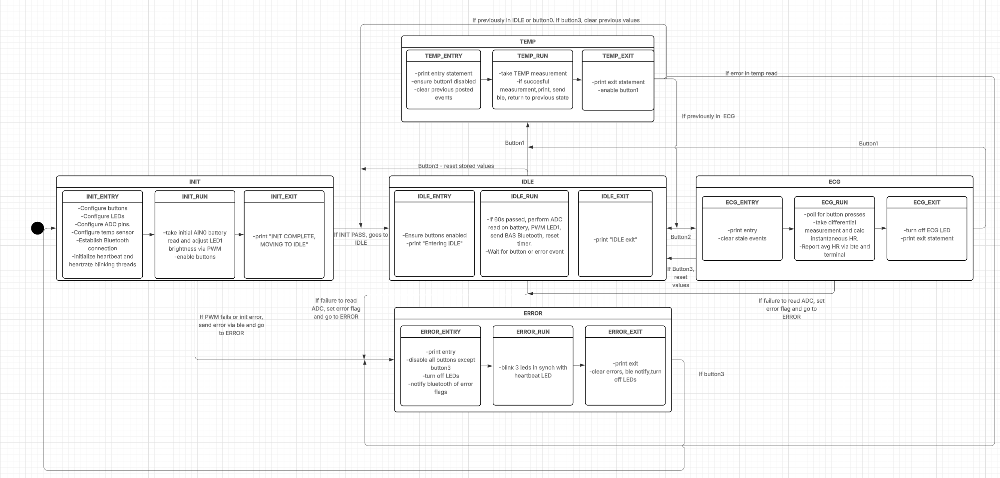

# ECG / Temperature Smartwatch Firmware (nRF52833, Zephyr RTOS)

Firmware for a wrist-worn health monitor prototype that measures heart rate from a single-lead ECG, reads skin temperature, tracks battery level, and reports everything over Bluetooth Low Energy. Built as the final project for Duke BME 554 (Embedded Medical Devices) on the Nordic nRF52833 DK.



## What it does

| Feature | How it works |
| --- | --- |
| **Application flow** | Zephyr State Machine Framework (SMF) with five states: `INIT`, `IDLE`, `ECG`, `TEMP`, `ERROR`. Each state has entry / run / exit handlers; button presses, ADC completion and battery timers are delivered to the state machine as kernel events rather than polled. |
| **ECG heart rate** | Differential ADC channel (AIN1/AIN2) sampled at 150 Hz with an asynchronous, buffered read. QRS peaks are detected with an amplitude threshold plus a refractory period, and heart rate is reported within a 40–200 BPM physiological range. An LED blinks at the measured heart rate. |
| **Temperature** | MCP9808 sensor over I2C, read on demand from the `TEMP` state. |
| **Battery** | Single-ended ADC measurement once a minute; battery level is shown as PWM LED brightness and reported over BLE. |
| **Bluetooth LE** | Custom GATT service with temperature, error-code, and message characteristics (notifications for subscribed clients), plus the standard Battery Service. |
| **Fault handling** | Each init/read failure sets a specific bit in an error bitmask. Fatal errors move the device to `ERROR` (all LEDs blink in sync with the heartbeat and the error code is sent over BLE); a reset button returns to `INIT`. |

## Design notes

- **No global state.** All runtime data (ADC buffers, callbacks, events, flags) lives in a single application context struct passed to each state and callback, with GPIO callbacks recovering it via `CONTAINER_OF`.
- **Event-driven.** Button ISRs only post kernel events and the state machine consumes them; ECG sampling uses an asynchronous ADC sequence with a completion callback. Two lightweight threads drive the heartbeat LED and the heart-rate blink LED independently of the state machine.
- **Hardware described in devicetree.** LEDs, buttons, ADC channels, PWM and the I2C sensor are defined by alias in `application/boards/nrf52833dk_nrf52833.overlay`, so the application code is board-independent.
- **Verified against recorded data.** `testing/final_technical_report.ipynb` analyzes ECG, temperature and battery measurements captured from the device (`testing/final_*_data.csv`) and explains the peak-detection approach.

## Repository layout

| Path | Contents |
| --- | --- |
| `application/src/main.c` | Application: state machine, sensing, heart-rate detection |
| `application/lib/ble-lib.c`, `application/include/ble-lib.h` | BLE GATT service and Battery Service |
| `application/boards/nrf52833dk_nrf52833.overlay` | Devicetree aliases for LEDs, buttons, ADC, PWM and I2C |
| `application/prj.conf` | Zephyr configuration |
| `application/CMakeLists.txt`, `CMakePresets.json`, `west.yml` | Build configuration |
| `testing/final_technical_report.ipynb` | Data analysis and verification report |
| `testing/final_*_data.csv` | Recorded ECG, temperature and battery data |
| `testing/bme554.py`, `test_bme554.py`, `conftest.py` | Course-provided analysis helpers and tests |
| `state_diagram_ecg_final.png` | State machine diagram |

## Authorship

- **Written by me:** `application/src/main.c` (all application logic, state machine, ECG acquisition and heart-rate detection, temperature and battery handling, error handling), the devicetree overlay and `prj.conf`, the state diagram, and the technical report and test data.
- **Adapted from course starter code:** `ble-lib.c` / `ble-lib.h`. I added the temperature and error-code characteristics, notification helpers, and integration with the application context.
- **Course-provided scaffolding:** build files (`CMakeLists.txt`, `CMakePresets.json`, `west.yml`) and the Python helper module and tests in `testing/`.

## Building

Requires the nRF Connect SDK / Zephyr toolchain.

```bash
west update                     # fetch Zephyr and dependencies (first time only)
west build -b nrf52833dk_nrf52833 application
west flash
```

## Author

Carson Pazdan · Duke BME '26 · [carsonpazdan.com](https://carsonpazdan.com)
